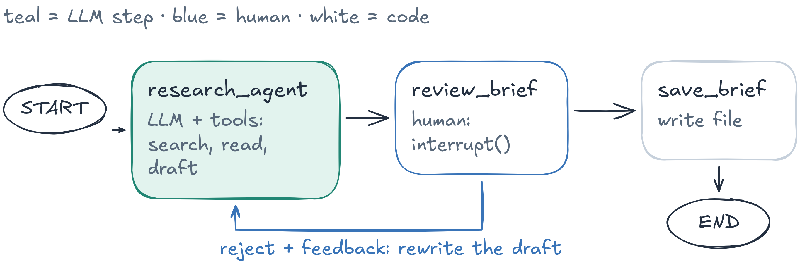

# Session 02 — Agent Loop Engineering with LangGraph

Build a **Research Brief Agent**: it searches the web, reads pages, writes a short brief with sources, asks you when the
request is unclear, waits for your approval before saving, streams its progress and survives a restart.
You first code the agent loop by hand with LangGraph to see how `create_agent` (and later Deep Agents) work inside,
then use `create_agent` itself.



## Notebooks

| Notebook                                                            | What you do                                                                                                                                                                                              |
| ------------------------------------------------------------------- | -------------------------------------------------------------------------------------------------------------------------------------------------------------------------------------------------------- |
| [01_agent_loop.ipynb](notebooks/01_agent_loop.ipynb)                 | tools, the agent loop with`StateGraph` (parallel tool calls), the same loop with `create_agent`, a `research_agent` node                                                                           |
| [02_complete_the_agent.ipynb](notebooks/02_complete_the_agent.ipynb) | `ask_user`, review before save, `SqliteSaver` and restart, streaming, retry and `recursion_limit`, `create_agent` + middleware; scenarios R01–R06; a **Gradio chat UI** on the same graph |

The notebooks contain the full solution and the outputs of a real run; explanations are in the notebooks.

## Setup

You need [uv](https://docs.astral.sh/uv/) and VS Code or Cursor with the **Python** and **Jupyter** extensions
(install steps in the [repository README](../../README.md)). Open a terminal **in this folder**:

```bash
cd sessions/02_agent_loop_langgraph
```

On Windows, use **PowerShell** for the commands below.

**1. Create the environment `venvAE02`** (uv downloads Python 3.12 if needed and installs the exact versions of `uv.lock`):

```bash
UV_PROJECT_ENVIRONMENT=venvAE02 uv sync                      # macOS / Linux
```

```powershell
$env:UV_PROJECT_ENVIRONMENT="venvAE02"; uv sync              # Windows PowerShell
```

**2. Register it as a notebook kernel** named `venvAE02`:

```bash
venvAE02/bin/python -m ipykernel install --user --name venvAE02 --display-name venvAE02        # macOS / Linux
```

```powershell
venvAE02\Scripts\python -m ipykernel install --user --name venvAE02 --display-name venvAE02    # Windows
```

**3. Add your API keys**: copy `.env.example` to `.env` in this folder (`cp .env.example .env`; Windows
`Copy-Item .env.example .env`), open `.env` and paste the keys.

- **OpenAI** (`OPENAI_API_KEY`)
  1. Sign in at https://platform.openai.com.
  2. **Settings → Billing**: add a payment method and a few dollars of credit (the API does not run on a ChatGPT subscription).
  3. **API keys** (https://platform.openai.com/api-keys) → **Create new secret key** → copy the key (`sk-…`); it is shown only once.
- **Tavily** (`TAVILY_API_KEY`)
  1. Sign up at https://app.tavily.com (Google or email); the free plan is enough for the labs.
  2. On the dashboard, copy the default key (`tvly-…`) or create one under **API Keys**.

**4. Open the lab in VS Code or Cursor**

1. **File → Open Folder… → `sessions/02_agent_loop_langgraph`** (this folder, not the whole repository).
   Accept the prompt to install the recommended extensions if they are missing.
2. Open `notebooks/01_agent_loop.ipynb` → **Select Kernel** (top right) → **Jupyter Kernel…** → **venvAE02**
   (or **Python Environments… → venvAE02**). If `venvAE02` is not listed, run **Developer: Reload Window** from the
   Command Palette (`Ctrl+Shift+P` / `Cmd+Shift+P`) and try again.
3. Run the cells one by one (`Shift+Enter`). Log lines (`INFO | …`) show each step while the agent runs.

## Troubleshooting

- `venvAE02` not in the kernel list: run step 2, install the **Jupyter** extension, open this folder (not the repository root), then **Developer: Reload Window**.
- `ModuleNotFoundError` or `Missing OPENAI_API_KEY`: the notebook is not on the `venvAE02` kernel (check with `import sys; print(sys.executable)`), step 1 was not run, or `.env` is missing in this folder.
- `uv: command not found`: reopen the terminal after installing uv.
- `AuthenticationError` or missing key: check `.env` in this folder, then restart the kernel.
- OpenAI `insufficient_quota`: add credit under **Settings → Billing**.
- Start over: delete `venvAE02/` (and `notebooks/checkpoints.sqlite` to reset the threads), then repeat step 1.

## References

[LangGraph quickstart](https://docs.langchain.com/oss/python/langgraph/quickstart) ·
[Graph API](https://docs.langchain.com/oss/python/langgraph/graph-api) ·
[create_agent](https://docs.langchain.com/oss/python/langchain/agents) ·
[Persistence](https://docs.langchain.com/oss/python/langgraph/checkpointers) ·
[Interrupts](https://docs.langchain.com/oss/python/langgraph/interrupts) ·
[Streaming](https://docs.langchain.com/oss/python/langgraph/streaming) ·
[Middleware](https://docs.langchain.com/oss/python/langchain/middleware/built-in) ·
[Tavily](https://docs.tavily.com/)
