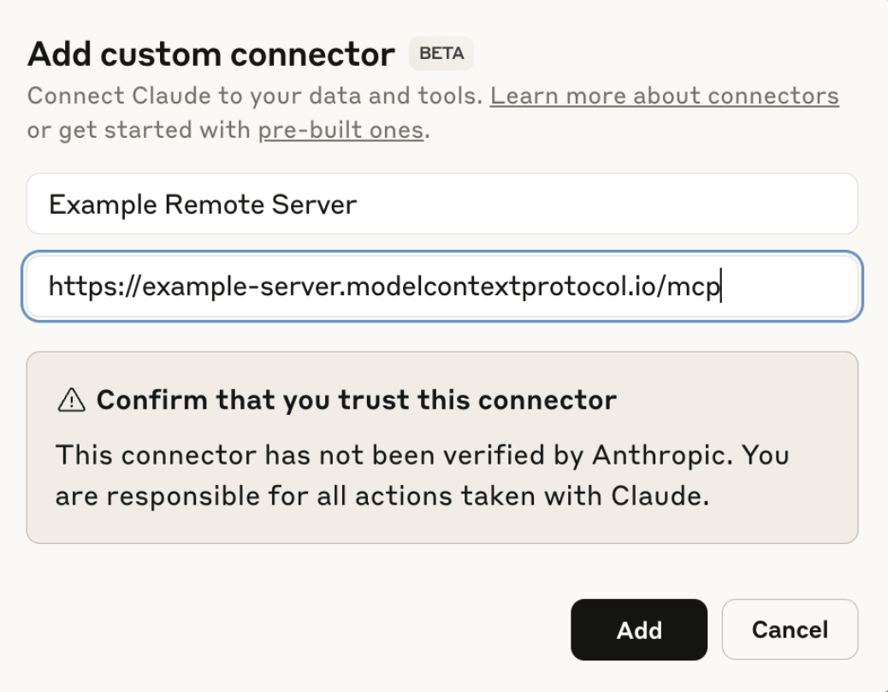
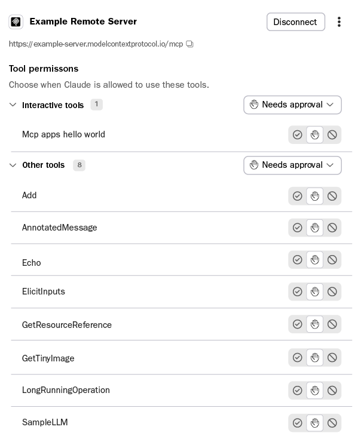
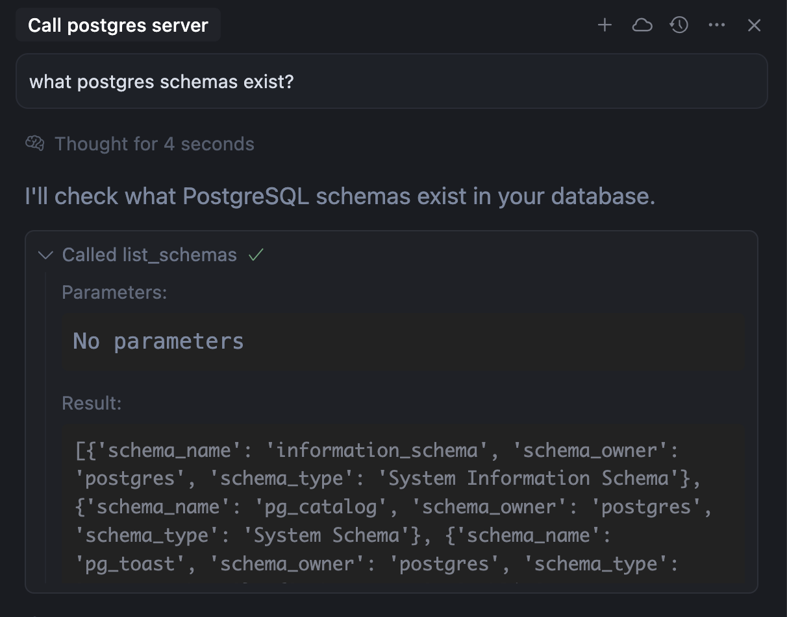
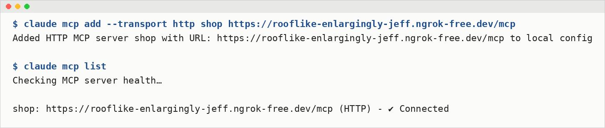
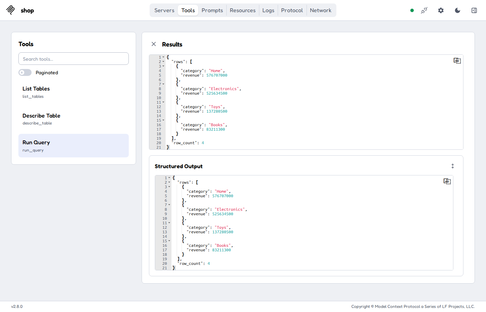

# Part 2 · A remote MCP server any agent can use

**What you do**: serve the three SQL tools from the MCP server `shop` (`app/shop_server.py`, **no authentication**), then
use it from your notebook agent and from Claude, Cursor or Claude Code. Anyone with the URL can read the data: demo
data only (part 3 adds API keys).

## 0. `.env`

Needs `OPENAI_API_KEY`, `TAVILY_API_KEY` (local tools `search_docs`, `read_doc`) and `SHOP_PORT` (default `8000`), plus `NGROK_AUTHTOKEN` for `--public`: [README, setup step 3](../README.md#3-set-up-env). `--public` opens the tunnel with the `ngrok` Python package (no ngrok command to install).

## 1. Start the server

In a terminal opened in the session folder (keep it running; it logs each query):

```bash
uv run app/shop_server.py --http            # http://localhost:8000/mcp  (port: SHOP_PORT in .env)
uv run app/shop_server.py --http --public   # plus a public https URL from ngrok
```

Set `UV_PROJECT_ENVIRONMENT=venvAE03` in the terminal first (README, setup step 1). `--public` needs `NGROK_AUTHTOKEN`
(section 0) and logs the public URL; the config of each app is below. Ctrl+C stops the server and the tunnel. The
server listens on `127.0.0.1` only (this machine); ngrok forwards the public URL to it.

```text
$ uv run app/shop_server.py --http --public
INFO | MCP server shop: http://localhost:8000/mcp
INFO | Public URL: https://<name>.ngrok-free.dev/mcp
INFO | run_query('SELECT city, COUNT(*) AS n FROM customers GROUP BY city ORDER BY n DE…) -> ok 0 ms
```

## 2. Your agent: notebook 02

Open `notebooks/02_remote_mcp_agent.ipynb` and run it. It checks the server at `http://localhost:$SHOP_PORT/mcp`, loads
the MCP tools with `MCPAdapter`, adds the local tools `search_docs` and `read_doc`, and streams the answer to the demo
question. With `--public`, put the logged https URL in `SHOP_MCP_URL` (optional, `.env`) to test the public path.

## 3. Claude (claude.ai or Claude Desktop)

Claude connects from Anthropic's cloud, so it needs the **https URL from `--public`**, not localhost.

1. **Customize → Connectors → Add custom connector** (Team / Enterprise: an owner uses **Organization settings → Connectors**).
2. Name `shop`, URL `https://<name>.ngrok-free.dev/mcp`, authentication **No sign-in** → **Add**.
3. In a chat: *"Using the shop connector, which product category had the highest revenue in Q3 2026?"* Allow the tools
   when Claude asks.

 

*Screenshots from the official MCP docs ([Connect to remote MCP servers](https://modelcontextprotocol.io/docs/develop/connect-remote-servers)).*

**Claude Desktop without ngrok (stdio)**: the app starts the server itself with `uv`. In *Settings → Developer →
Edit Config* (`claude_desktop_config.json`), with the absolute path of this folder, then restart the app:

```json
{ "mcpServers": { "shop": { "command": "uv",
                            "args": ["run", "--directory", "/abs/path/sessions/03_tool_mcp", "app/shop_server.py"],
                            "env": { "UV_PROJECT_ENVIRONMENT": "venvAE03" } } } }
```

`env` makes `uv` use `venvAE03` (Claude Desktop does not read your terminal's variables). If Claude says `uv` is not
found, put the full path of `uv` in `command` (`which uv`; Windows `where.exe uv`).

## 4. Cursor

`.cursor/mcp.json` in your project (or `~/.cursor/mcp.json`). Cursor runs on your machine, so localhost works:

```json
{ "mcpServers": { "shop": { "url": "http://localhost:8000/mcp" } } }
```

**Cursor Settings → MCP** shows `shop` with 3 tools; ask the agent in chat.



*Screenshot from the official [Cursor MCP docs](https://cursor.com/docs/mcp).*

## 5. Claude Code

```bash
claude mcp add --transport http shop http://localhost:8000/mcp     # or the https URL
claude mcp list                                                    # shop: ... - ✔ Connected
claude -p "Which city has the most customers in the shop database?" --allowedTools "mcp__shop__*"
claude mcp remove shop
```



## Optional: MCP Inspector (test without a model)

`npx @modelcontextprotocol/inspector` (Node ≥ 22.19) → **Add Servers → Add manually** → transport `streamable-http`,
your URL → **Tools** → `run_query` → **Execute Tool**.



## Troubleshooting

- Notebook: `No MCP server at ...`: start the server (step 1); check `SHOP_PORT` (and `SHOP_MCP_URL`, if set) in `.env`.
- Claude cannot reach the server: use the https URL with `/mcp`, keep the terminal running.
- Claude Desktop stdio: *Settings → Developer* shows the server log; check the folder path and the `uv` path.
- `ngrok did not start`: set `NGROK_AUTHTOKEN` in `.env`. Port in use: change `SHOP_PORT`.
- Inspector fails with `CustomEvent is not defined`: Node is older than 22.19.

## References

- MCP architecture: https://modelcontextprotocol.io/docs/learn/architecture
- Claude custom connectors: https://support.claude.com/en/articles/11175166-get-started-with-custom-connectors-using-remote-mcp
- Cursor MCP: https://cursor.com/docs/mcp · Claude Code MCP: https://code.claude.com/docs/en/mcp
- LangChain MCP: https://docs.langchain.com/oss/python/langchain/mcp · FastMCP: https://gofastmcp.com
