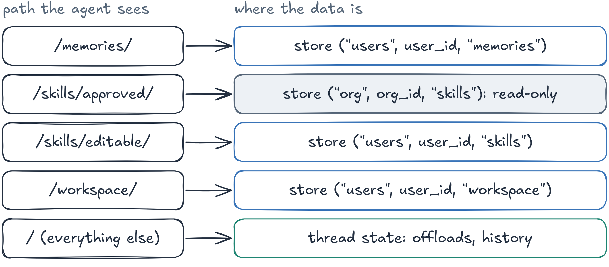

# Session 04 — Context Engineering with Prompts, Skills and Memory

Build a **Research Brief Agent** with LangChain [Deep Agents](https://docs.langchain.com/oss/python/deepagents/overview)
(`create_deep_agent`). Part by part, the agent gets a structured prompt and a Skill, memory and files, context
compression for long tasks, and separate memory, skills and files for each user.



## Notebooks

| Notebook                                                                | What you do                                                                                  |
| ----------------------------------------------------------------------- | -------------------------------------------------------------------------------------------- |
| [01_prompt_and_skill.ipynb](notebooks/01_prompt_and_skill.ipynb)         | System prompt in sections, the Skill`research-brief`, what the model receives on each call |
| [02_memory_and_files.ipynb](notebooks/02_memory_and_files.ipynb)         | `/memories/AGENTS.md` across threads and restarts, artifacts in `/workspace/`            |
| [03_context_optimization.ipynb](notebooks/03_context_optimization.ipynb) | Offloading and summarization with low thresholds, a progress file for the next thread        |
| [04_multi_user.ipynb](notebooks/04_multi_user.ipynb)                     | Alice and Bob on one agent: memory, skills and workspace per user, read-only shared skills   |

The notebooks contain the full solution and the outputs of a real run. Shared pieces: the system prompt
[prompts/system_prompt.md](prompts/system_prompt.md), the Skill [skills/research-brief/](skills/research-brief/), and the helpers
[notebooks/utils.py](notebooks/utils.py) (web tools, streaming, a `/context`-style view of each model call).
Files the agent writes go to `notebooks/output/` (safe to delete).

## Setup
You need [uv](https://docs.astral.sh/uv/) and VS Code or Cursor with the **Python** and **Jupyter** extensions
(install steps in the [repository README](../../README.md)). Open a terminal **in this folder**:
```bash
cd sessions/04_context_engineering
```
On Windows, use **PowerShell** for the commands below.

### 1. Create the environment `venvAE04`
uv downloads Python 3.12 if needed and installs the exact versions of `uv.lock`:
```bash
export UV_PROJECT_ENVIRONMENT=venvAE04 && uv sync              # macOS / Linux
```
```powershell
$env:UV_PROJECT_ENVIRONMENT="venvAE04"; uv sync                # Windows PowerShell
```
`UV_PROJECT_ENVIRONMENT` tells every later `uv run` in this terminal to use `venvAE04`; set it again in each new terminal.

### 2. Register it as a notebook kernel
Named `venvAE04`:
```bash
uv run python -m ipykernel install --user --name venvAE04 --display-name venvAE04
```
Same command on every OS, in the terminal where you set `UV_PROJECT_ENVIRONMENT` (step 1).

### 3. Set up `.env`
Copy `.env.example` to `.env` in this folder (`cp .env.example .env`; Windows `Copy-Item .env.example .env`), open
`.env` and paste the keys (no quotes, no spaces around `=`); restart the kernel after you change it.
`MODEL` is any `provider:model` of LangChain `init_chat_model`.
- **OpenAI** (`OPENAI_API_KEY`)
  1. Sign in at https://platform.openai.com.
  2. **Settings → Billing**: add a payment method and a few dollars of credit (the API does not run on a ChatGPT subscription).
  3. **API keys** (https://platform.openai.com/api-keys) → **Create new secret key** → copy the key (`sk-…`); it is shown only once.
- **Tavily** (`TAVILY_API_KEY`)
  1. Sign up at https://app.tavily.com (Google or email); the free plan is enough for the labs.
  2. On the dashboard, copy the default key (`tvly-…`) or create one under **API Keys**.

### 4. Open the lab in VS Code or Cursor
1. **File → Open Folder… → `sessions/04_context_engineering`** (this folder, not the whole repository).
   Accept the prompt to install the recommended extensions if they are missing.
2. Open a notebook in `notebooks/` → **Select Kernel** (top right) → **Jupyter Kernel…** → **venvAE04**
   (or **Python Environments… → venvAE04**). If `venvAE04` is not listed, run **Developer: Reload Window** from the
   Command Palette (`Ctrl+Shift+P` / `Cmd+Shift+P`) and try again.
3. Run the cells one by one (`Shift+Enter`). `INFO | …` lines are logs (diagnostics from the code);
   `→` / `←` lines and the answer are the agent's streamed output.

## Troubleshooting

- `venvAE04` not in the kernel list: run step 2, install the **Jupyter** extension, open this folder (not the repository root), then **Developer: Reload Window**.
- **The Skill is never read**: its `description` must say what it does *and when to use it*; a vague one ("Helps with research") is the usual cause.
- **A new skill or a memory change does not show up**: skills and memory are loaded once per thread. Use a new `thread_id`, or reset with
  `agent.update_state(config, {"skills_metadata": None})`.
- **No offload or summary in Part 3**: the thresholds are compared with the size of your context; lower `offload_limit` / `summarize_at`.
- **`TypeError: ... namespace`**: every `StoreBackend` needs `namespace=lambda rt: (...)`.
- **`context` is `None` / `AttributeError: user_id`**: create the agent with `context_schema=UserContext` and pass `context=UserContext(...)` to `invoke`.
- **Bob sees Alice's data**: every namespace must contain `rt.context.user_id`; a fixed namespace is shared by all users.
- **A user's copy replaces a shared skill**: when two sources have a skill with the same name, the source listed last wins; list `/skills/approved/` last in `skills=[...]`.
- **SQLite "database is locked"** (Part 2): close other notebooks that use `output/memory.sqlite`.

## References

- https://docs.langchain.com/oss/python/deepagents/context-engineering
- https://docs.langchain.com/oss/python/deepagents/skills
- https://docs.langchain.com/oss/python/deepagents/memory
- https://docs.langchain.com/oss/python/deepagents/backends
- https://docs.langchain.com/oss/python/deepagents/customization
- https://www.anthropic.com/engineering/effective-context-engineering-for-ai-agents
- https://agentskills.io/specification
