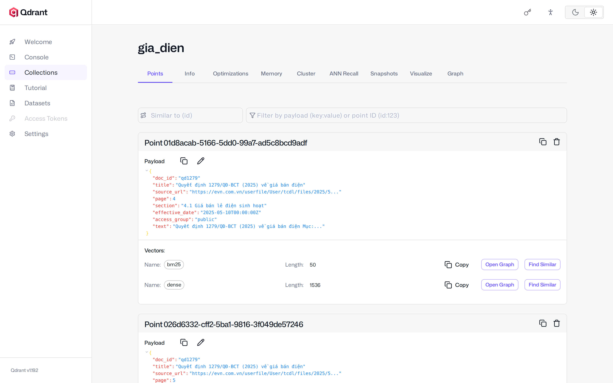

# Session 05 — Advanced Retrieval and Vector Databases for Agents

Give a [Deep Agent](https://docs.langchain.com/oss/python/deepagents/overview) a search tool over your documents. Part 1
builds retrieval by hand on one Markdown guide (chunks, embeddings, BM25, rank fusion). Part 2 builds a knowledge base of
real Vietnamese PDFs (scans, tables, several versions) on a **Qdrant** server in Docker, with hybrid search, access
control and citations, and looks at it in the Qdrant dashboard.



## Notebooks

| Notebook                                                                    | What you do                                                                                                                                                                                                                                                                                                                                                                                                        |
| --------------------------------------------------------------------------- | ------------------------------------------------------------------------------------------------------------------------------------------------------------------------------------------------------------------------------------------------------------------------------------------------------------------------------------------------------------------------------------------------------------------ |
| [01_basic_rag.ipynb](notebooks/01_basic_rag.ipynb)                           | In memory, on `data/ev_battery_guide.md`: Markdown chunking, `text-embedding-3-small`, cosine search, BM25, RRF, the tool `search_guide`, a Deep Agent that answers with citations                                                                                                                                                                                                                           |
| [02_qdrant_documents_agent.ipynb](notebooks/02_qdrant_documents_agent.ipynb) | 4 PDFs in `data/pdfs/`: text layer or OCR with the session model, table-aware chunks, the Qdrant collection `gia_dien` (dense + BM25 vectors, payload indexes), dense vs BM25 vs hybrid, the tool `search_kb` with access groups from the runtime context, agent scenarios (old vs current prices, a rule not applied yet, `public` vs `finance` user, out of scope); optional LLM rerank and MCP server |

The notebooks contain the full solution and the outputs of a real run. Shared pieces: the system prompt
[prompts/system_prompt.md](prompts/system_prompt.md), the helpers [notebooks/utils.py](notebooks/utils.py), the
ingest code [app/ingest.py](app/ingest.py) and the Qdrant code [app/kb.py](app/kb.py). Optional MCP server:
[docs/02_mcp_server.md](docs/02_mcp_server.md).

## Setup

You need [uv](https://docs.astral.sh/uv/), VS Code or Cursor with the **Python** and **Jupyter** extensions
(install steps in the [repository README](../../README.md)), and for Part 2 Docker (step 5).
Open a terminal **in this folder**:

```bash
cd sessions/05_advanced_retrieval
```

On Windows, use **PowerShell** for the commands below.

### 1. Create the environment `venvAE05`

uv downloads Python 3.12 if needed and installs the exact versions of `uv.lock`:

```bash
export UV_PROJECT_ENVIRONMENT=venvAE05 && uv sync              # macOS / Linux
```

```powershell
$env:UV_PROJECT_ENVIRONMENT="venvAE05"; uv sync                # Windows PowerShell
```

`UV_PROJECT_ENVIRONMENT` tells every later `uv run` in this terminal to use `venvAE05`; set it again in each new terminal.

### 2. Register it as a notebook kernel

```bash
uv run python -m ipykernel install --user --name venvAE05 --display-name venvAE05
```

Same command on every OS, in the terminal where you set `UV_PROJECT_ENVIRONMENT` (step 1).

### 3. Set up `.env`

Copy `.env.example` to `.env` in this folder (`cp .env.example .env`; Windows `Copy-Item .env.example .env`), open
`.env` and paste the key (no quotes, no spaces around `=`); restart the kernel after you change it.
`MODEL` is any `provider:model` of LangChain `init_chat_model`; the OCR step of Part 2 needs a model that reads images.

- **OpenAI** (`OPENAI_API_KEY`), used for the model and the embeddings

  1. Sign in at https://platform.openai.com.
  2. **Settings → Billing**: add a payment method and a few dollars of credit (the API does not run on a ChatGPT subscription).
  3. **API keys** (https://platform.openai.com/api-keys) → **Create new secret key** → copy the key (`sk-…`); it is shown only once.
- **ngrok** (`NGROK_AUTHTOKEN`, optional: a public URL for the MCP server of [docs/02_mcp_server.md](docs/02_mcp_server.md), for claude.ai and other cloud apps)

  1. Sign up at https://dashboard.ngrok.com/signup → **Your Authtoken** → copy it into `NGROK_AUTHTOKEN` in `.env`.
  2. Nothing to install: `--public` opens the tunnel with the `ngrok` Python package (already in `uv.lock`).
- **MCP API key** (`KB_READ_KEY`, optional, with `--public`): a long random string every client of the public server
  sends; make it with `uv run python -c "import secrets; print(secrets.token_urlsafe(24))"`.

A full run of both notebooks costs a few US cents.

### 4. Open the lab in VS Code or Cursor

1. **File → Open Folder… → `sessions/05_advanced_retrieval`** (this folder, not the whole repository).
   Accept the prompt to install the recommended extensions if they are missing.
2. Open a notebook in `notebooks/` → **Select Kernel** (top right) → **Jupyter Kernel…** → **venvAE05**
   (or **Python Environments… → venvAE05**). If `venvAE05` is not listed, run **Developer: Reload Window** from the
   Command Palette (`Ctrl+Shift+P` / `Cmd+Shift+P`) and try again.
3. Run the cells one by one (`Shift+Enter`). `INFO | …` lines are logs; `→` / `←` lines and the answer are the agent's
   streamed output.

### 5. Install Docker and start Qdrant (Part 2)

Part 2 runs the Qdrant vector database in a Docker container. Install Docker once:

- **Windows 10/11**: install [Docker Desktop](https://docs.docker.com/desktop/setup/install/windows-install/)
  (keep the default *Use WSL 2*; restart when asked), then start **Docker Desktop** from the Start menu.
- **macOS**: install [Docker Desktop](https://docs.docker.com/desktop/setup/install/mac-install/) (pick *Apple silicon*
  or *Intel* to match your Mac), then open **Docker** from Applications.
- **Linux**: install [Docker Engine](https://docs.docker.com/engine/install/) with the `docker-compose-plugin` package,
  then let your user run Docker without `sudo`: `sudo usermod -aG docker $USER` and log out and in again.

Check it in a new terminal (all three must work):

```bash
docker --version
docker compose version
docker run --rm hello-world        # prints "Hello from Docker!"
```

Then, in this folder:

```bash
docker compose up -d        # downloads qdrant/qdrant:v1.19.2 the first time, starts container qdrant-ae05
docker compose ps           # STATUS must say "Up"
```

Open the dashboard at http://localhost:6333/dashboard. The container starts again with Docker after a reboot. Stop it
with `docker compose down` when you are done; the data stays in the Docker volume `qdrant_ae05_data`
(`docker compose down -v` deletes it). To rebuild the collection without the notebook: `uv run app/ingest.py`.

## Troubleshooting

- `venvAE05` not in the kernel list: run step 2, install the **Jupyter** extension, open this folder (not the repository root), then **Developer: Reload Window**.
- **`No Qdrant server at http://127.0.0.1:6333`**: Docker is not started, or the container is stopped. Start Docker
  Desktop (Linux: `sudo systemctl start docker`), then in this folder `docker compose up -d` and `docker compose ps`
  (STATUS `Up`). Still failing: `docker compose logs qdrant` shows why the container stopped.
- **`Cannot connect to the Docker daemon`**: Docker Desktop is not running (wait until it says *Engine running*).
  Linux `permission denied … docker.sock`: run the `usermod` command of step 5 and log in again.
- **`port is already allocated`**: another program uses port 6333 (often an old Qdrant container: `docker ps`); stop it,
  or change the left port in `docker-compose.yml` and set `QDRANT_URL=http://127.0.0.1:<port>` in `.env`.
- **BM25 finds nothing, or misses words like `thẻ`, `tơ`**: the BM25 options must be the same when indexing and when querying (`kb.BM25_OPTIONS`); after changing them, rebuild the collection. With `ascii_folding`, keep stopwords and stemmer disabled.
- **`Wrong input: Not existing vector name error`** (400 Bad Request): the collection has named vectors, so every query needs `using="dense"` or `using="bm25"`.
- **OCR**: the scanned pages are read from `data/ocr/` (shipped with the lab), so no OCR cost; delete a file there (or run `uv run app/ingest.py --no-cache`) to OCR again. A model without image input fails on the live OCR cell.
- **The agent gives the 2024 price**: the search must return both versions of the table (`kb.TOP_K = 8`) so the prompt rule "prefer the document that applies today" can work.
- **`ngrok did not start … is already online`**: the free plan gives one fixed domain per account; stop the other `--public` server using the same `NGROK_AUTHTOKEN` (e.g. Session 03's), then start again. Other `ngrok did not start` errors: check `NGROK_AUTHTOKEN` in `.env`.
- **A `public` user sees the internal note**: the access groups must come from `runtime.context` (agent created with `context_schema=UserContext`, called with `context=UserContext(...)`), never from a tool argument.

## References

- https://docs.langchain.com/oss/python/deepagents/rag
- https://docs.langchain.com/oss/python/langchain/runtime
- https://docs.langchain.com/oss/python/integrations/splitters/markdown_header_metadata_splitter
- https://qdrant.tech/documentation/concepts/hybrid-queries/
- https://qdrant.tech/documentation/concepts/filtering/
- https://qdrant.tech/documentation/web-ui/
- https://pymupdf.readthedocs.io/en/latest/recipes-text.html
- https://plg.uwaterloo.ca/~gvcormac/cormacksigir09-rrf.pdf
