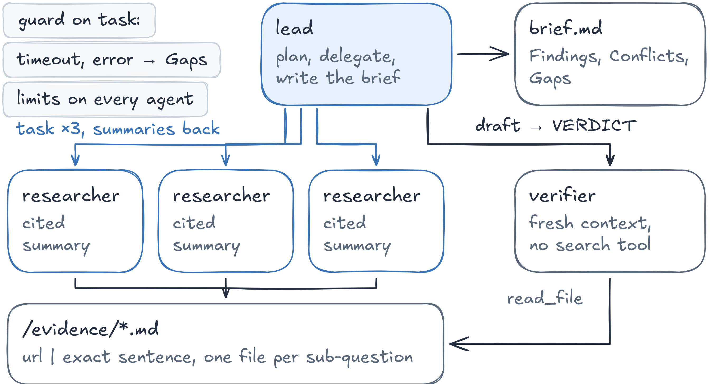

# Session 06 — Multi-Agent Engineering

Turn the **Research Brief Agent** into a multi-agent system with LangChain
[Deep Agents](https://docs.langchain.com/oss/python/deepagents/overview): compare the coordination patterns on one
request, run subagents in the background on a local Agent Server, then build a complete lead + researchers + verifier
agent with budgets, timeouts and evidence files. The example topic is home electrification (heat pumps, EV batteries).



## Notebooks

| Notebook | What you do |
| --- | --- |
| [01_coordination_patterns.ipynb](notebooks/01_coordination_patterns.ipynb) | One request, four patterns: subagents and skills (Deep Agents), router (LangGraph `Send`), handoffs (LangGraph `Command`); model calls and tokens per pattern |
| [02_async_subagents.ipynb](notebooks/02_async_subagents.ipynb) | Background subagents: the notebook starts `langgraph dev` with `supervisor` and `researcher` in one deployment; launch, keep talking, watch them run, check, update, cancel; launch and check limits |
| [03_research_brief_agent.ipynb](notebooks/03_research_brief_agent.ipynb) | The complete agent: task descriptions, cited text summaries, `/evidence/` files, parallel `task` calls, per-agent limits, a guard for errors and timeouts, a verifier with a fresh context |

The notebooks contain the full solution and the outputs of a real run. Shared pieces: the prompts in
[prompts/](prompts/), the two Skills of Part 1 in [skills/](skills/), the web search tool [app/tools.py](app/tools.py),
the Part 2 graphs [app/supervisor.py](app/supervisor.py) and [app/researcher.py](app/researcher.py) (registered in
[langgraph.json](langgraph.json), served by `langgraph dev`) and the helpers [notebooks/utils.py](notebooks/utils.py) (streaming with one line per
agent step, a usage table per agent). The final brief goes to `notebooks/output/` (safe to delete).

**Cost:** every agent uses `MODEL`; each subagent run is capped (2 searches, 4–5 model calls) and supervisors cap how
many tasks they launch, so the cost of a run is known in advance (see the usage tables printed by the notebooks).

## Setup
You need [uv](https://docs.astral.sh/uv/) and VS Code or Cursor with the **Python** and **Jupyter** extensions
(install steps in the [repository README](../../README.md)). Open a terminal **in this folder**:
```bash
cd sessions/06_multi_agent
```
On Windows, use **PowerShell** for the commands below.

### 1. Create the environment `venvAE06`
uv downloads Python 3.12 if needed and installs the exact versions of `uv.lock`:
```bash
export UV_PROJECT_ENVIRONMENT=venvAE06 && uv sync              # macOS / Linux
```
```powershell
$env:UV_PROJECT_ENVIRONMENT="venvAE06"; uv sync                # Windows PowerShell
```
`UV_PROJECT_ENVIRONMENT` tells every later `uv run` in this terminal to use `venvAE06`; set it again in each new terminal.

### 2. Register it as a notebook kernel
Named `venvAE06`:
```bash
uv run python -m ipykernel install --user --name venvAE06 --display-name venvAE06
```
Same command on every OS, in the terminal where you set `UV_PROJECT_ENVIRONMENT` (step 1).

### 3. Set up `.env`
Copy `.env.example` to `.env` in this folder (`cp .env.example .env`; Windows `Copy-Item .env.example .env`), open
`.env` and paste the keys (no quotes, no spaces around `=`); restart the kernel after you change it.
`MODEL` is any `provider:model` of LangChain `init_chat_model`; every agent of the lab uses it.
- **OpenAI** (`OPENAI_API_KEY`)
  1. Sign in at https://platform.openai.com.
  2. **Settings → Billing**: add a payment method and a few dollars of credit (the API does not run on a ChatGPT subscription).
  3. **API keys** (https://platform.openai.com/api-keys) → **Create new secret key** → copy the key (`sk-…`); it is shown only once.
- **Tavily** (`TAVILY_API_KEY`)
  1. Sign up at https://app.tavily.com (Google or email); the free plan is enough for the labs.
  2. On the dashboard, copy the default key (`tvly-…`) or create one under **API Keys**.

### 4. Open the lab in VS Code or Cursor
1. **File → Open Folder… → `sessions/06_multi_agent`** (this folder, not the whole repository).
   Accept the prompt to install the recommended extensions if they are missing.
2. Open a notebook in `notebooks/` → **Select Kernel** (top right) → **Jupyter Kernel…** → **venvAE06**
   (or **Python Environments… → venvAE06**). If `venvAE06` is not listed, run **Developer: Reload Window** from the
   Command Palette (`Ctrl+Shift+P` / `Cmd+Shift+P`) and try again.
3. Run the cells one by one (`Shift+Enter`). `INFO | …` lines are logs; `[agent] →` / `[agent] ←` lines and the answer
   are the agents' streamed output.

## Troubleshooting

- `venvAE06` not in the kernel list: run step 2, install the **Jupyter** extension, open this folder (not the repository root), then **Developer: Reload Window**.
- **`Agent Server did not start`** (Part 2): read `notebooks/output/langgraph_dev.log`; port 2024 must be free (stop another `langgraph dev`).
- **Async tasks stay `pending`**: all worker slots are busy; wait, or raise `--n-jobs-per-worker`.
- **Tasks finish too fast or too slow to watch**: change `RESEARCH_DELAY_S` in `app/researcher.py` (0 = real speed).
- **The supervisor uses `general-purpose` instead of your specialist**: make the specialist's `description` say exactly which questions it answers.
- **`Tool call limit exceeded`**: a budget fired on purpose (`ToolCallLimitMiddleware`); raise the limit only if you accept the cost.

## References

- https://docs.langchain.com/oss/python/langchain/multi-agent
- https://docs.langchain.com/oss/python/deepagents/subagents
- https://docs.langchain.com/oss/python/deepagents/async-subagents
- https://docs.langchain.com/oss/python/langchain/middleware/built-in
- https://www.anthropic.com/engineering/multi-agent-research-system
