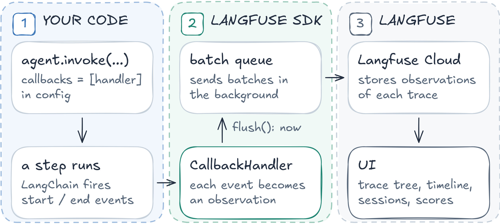

# Session 07 — Observability and Evaluation Engineering

Trace the **Research Brief Agent** with [Langfuse](https://langfuse.com), then measure it: the agent's prompts live in Langfuse
**Prompt Management**, the eval cases become a Langfuse **dataset**, code checks and an LLM judge score two prompt versions in an
**experiment**, and the cases of fixed bugs are rerun as **regression**.



## Notebooks
| Notebook | What you do |
|---|---|
| [01_trace_the_agent.ipynb](notebooks/01_trace_the_agent.ipynb) | Part A: automatic tracing with one `CallbackHandler`. Part B: root observation, `user_id` / `session_id` / `tags`, prompt version, an image, a feedback score |
| [02_eval_set_and_experiments.ipynb](notebooks/02_eval_set_and_experiments.ipynb) | Dataset → task → code evaluators and LLM judge → experiment prompt v1 vs v2 → scores per prompt version → regression |

Tools of the agent: [app/tools.py](app/tools.py). Prompts to copy into Langfuse: [prompts/](prompts). Eval cases: [data/eval_cases.jsonl](data/eval_cases.jsonl).

## Setup
Open a terminal **in this folder** (`cd sessions/07_observability_eval`); on Windows use **PowerShell**.

**1. Create the environment `venvAE07`**
```bash
export UV_PROJECT_ENVIRONMENT=venvAE07 && uv sync              # macOS / Linux
```
```powershell
$env:UV_PROJECT_ENVIRONMENT="venvAE07"; uv sync                # Windows PowerShell
```

**2. Register it as a notebook kernel** (same terminal)
```bash
uv run python -m ipykernel install --user --name venvAE07 --display-name venvAE07
```

**3. Set up `.env`**: copy `.env.example` to `.env` (`cp .env.example .env`; Windows `Copy-Item .env.example .env`) and paste the keys
(no quotes, no spaces around `=`).
- `OPENAI_API_KEY`: https://platform.openai.com/api-keys → **Create new secret key** (add a few dollars of credit under **Settings → Billing**).
- `TAVILY_API_KEY`: sign up at https://app.tavily.com, copy the default key (`tvly-…`).
- `LANGFUSE_PUBLIC_KEY`, `LANGFUSE_SECRET_KEY`, `LANGFUSE_BASE_URL`: sign up at https://cloud.langfuse.com (EU) or
  https://us.cloud.langfuse.com (US), create an organization and a project (free **Hobby** plan), then **Project settings → API Keys →
  Create new API keys**. `LANGFUSE_BASE_URL` is the address you signed up on.
- `MODEL` (agent) and `JUDGE_MODEL` (optional, the LLM judge; empty = same as `MODEL`): any `provider:model` of `init_chat_model`.

**4. Open the lab in VS Code or Cursor**: **File → Open Folder… → `sessions/07_observability_eval`**, open a notebook, **Select Kernel →
Jupyter Kernel… → venvAE07** (not listed: **Developer: Reload Window**). Run the cells one by one.

**5. Create the prompts in Langfuse** (the code only fetches them by name and label). The texts are in [prompts/](prompts):

| File | Langfuse prompt | Label |
|---|---|---|
| [prompts/research-brief_v1.txt](prompts/research-brief_v1.txt) | `research-brief`, version 1 | `v1` |
| [prompts/research-brief_v2.txt](prompts/research-brief_v2.txt) | `research-brief`, version 2 | `v2` |
| [prompts/research-brief-judge.txt](prompts/research-brief-judge.txt) | `research-brief-judge` | `production` |

1. In your project open **Prompts → + New prompt**.
2. Name `research-brief`, type **Text**. Open `prompts/research-brief_v1.txt`, select all, copy, paste it into the prompt box. Add the
   label `v1` and leave `production` unchecked. **Create prompt**.
3. Open `research-brief` → **+ New version**, replace the text with the content of `prompts/research-brief_v2.txt`, label `v2` only.
   **Save**. The prompt now has version 1 (`v1`) and version 2 (`v2`).
4. **+ New prompt** again: name `research-brief-judge`, type **Text**, paste `prompts/research-brief-judge.txt`, keep the label
   `production`. **Create prompt**. Check that the variables `{{question}}`, `{{brief}}`, `{{evidence}}` are detected.

The notebooks stop with `Prompt ... not found in Langfuse` if a name or label is wrong. After an edit in the UI, the SDK sees the change
within 60 seconds (prompt cache).

**After Notebook 2:** see the results per version in **Prompts → research-brief → Metrics**, then promote the better version: select
version 2 → **Labels** → add `production`.

## Troubleshooting
- `Langfuse rejected the keys`: keys and `LANGFUSE_BASE_URL` must come from the same region (EU or US).
- No trace in the UI: traces are sent in the background; the notebooks call `langfuse.flush()`, wait a few seconds and refresh.
- **Metrics** of a prompt shows no scores: run the cell of section 6 in Notebook 2 (it attaches the scores to the linked model calls).
- Numbers differ between runs: one trial per case is noisy (one or two items of difference is not a conclusion).
- `read_doc` returns `ERROR: only pages under ...`: only `docs.langchain.com/oss/python/` pages can be read.

## References
- Langfuse: [LangChain integration](https://langfuse.com/integrations/frameworks/langchain) · [data model](https://langfuse.com/docs/observability/data-model) · [prompt management](https://langfuse.com/docs/prompt-management/overview) · [link prompts to traces](https://langfuse.com/docs/prompt-management/features/link-to-traces) · [datasets](https://langfuse.com/docs/evaluation/experiments/datasets) · [experiments via SDK](https://langfuse.com/docs/evaluation/experiments/experiments-via-sdk) · [scores](https://langfuse.com/docs/evaluation/scores/overview)
- Anthropic, [Demystifying evals for AI agents](https://www.anthropic.com/engineering/demystifying-evals-for-ai-agents) · Hamel Husain, [Using LLM-as-a-judge](https://hamel.dev/blog/posts/llm-judge/)
