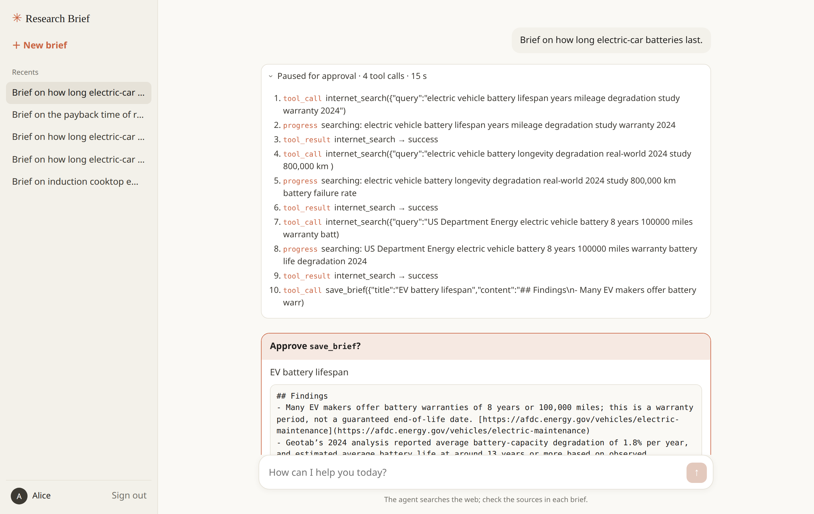

# Session 09 — Agent API Engineering with FastAPI

The product of this session is a **FastAPI service** that serves the Research Brief Agent (a
[Deep Agent](https://docs.langchain.com/oss/python/deepagents/overview) with web search) over HTTP, plus a demo chat UI.
Each run streams to the client as [Server-Sent Events](https://fastapi.tiangolo.com/tutorial/server-sent-events/): steps,
tool calls, search progress, tokens, a request for approval before a brief is saved, and the end of the run. Users sign
in with a bearer token and only ever see their own threads.



## The service

```
app/
  main.py               FastAPI app: lifespan (model, checkpointer, store), routers, error handlers, UI
  core/config.py        Settings from environment variables and .env (pydantic-settings)
  core/security.py      Bearer token -> User (401 otherwise)
  core/errors.py        RFC 9457 Problem Details for every error
  schemas.py            Request and response models (Pydantic)
  dependencies.py       Shared checks: thread ownership (404), thread state (409)
  routers/              health.py (/health, /ready) · threads.py (/me, /threads) · runs.py (runs, resume: SSE)
  services/threads.py   Thread records in the LangGraph store, one namespace per user
  services/streaming.py LangGraph stream -> SSE events (metadata, step, tool_call, progress, tool_result, token,
                        interrupt, done, error)
  agent/                The Research Brief Agent (graph.py, tools.py, prompts/)
  static/               Demo UI (index.html, app.css, app.js)
data/users.json         Demo users and tokens (a real service uses an identity provider)
```

| Route | What it does |
| --- | --- |
| `GET /health`, `GET /ready` | liveness, readiness (no token) |
| `GET /me` | the signed-in user |
| `POST /threads`, `GET /threads`, `GET /threads/{thread_id}` | create, list, read your threads |
| `POST /threads/{thread_id}/runs` | send a message; the response is a `text/event-stream` |
| `POST /threads/{thread_id}/resume` | approve or reject the pending `save_brief`; streams the rest of the run |

Threads and checkpoints are kept in `output/` (SQLite), saved briefs in `output/briefs/<user_id>/`. Stop the service
and delete `output/` to start clean.

## Notebooks: the service, part by part

Each notebook shows the source of the functions of one layer, calls them, prints what they return, then runs the
same feature on the running service.

| Notebook | Part | Time |
| --- | --- | --- |
| [01_structure_settings_schemas.ipynb](notebooks/01_structure_settings_schemas.ipynb) | Project layout, `Settings`, Pydantic schemas, the app object and its routes, OpenAPI / Swagger UI | ~12 min |
| [02_streaming_sse.ipynb](notebooks/02_streaming_sse.ipynb) | The agent; LangGraph stream chunks → events (`to_events`); a run as SSE (`run_events`) on the wire; the real HTTP stream to the approval step | ~12 min |
| [03_auth_isolation_approval.ipynb](notebooks/03_auth_isolation_approval.ipynb) | `current_user`; one store namespace per user; Bob tries every route to Alice's thread (PASS/FAIL); approve and reject over `/resume` | ~13 min |
| [04_errors_health_ui.ipynb](notebooks/04_errors_health_ui.ipynb) | Problem Details before the stream; `event: error` during it; timeout and client disconnect; `/health` vs `/ready`; the demo UI | ~13 min |

Optional (~10 min, end of Notebook 04): trace each API run in Langfuse per user and thread.

## Setup
You need [uv](https://docs.astral.sh/uv/) and VS Code or Cursor with the **Python** and **Jupyter** extensions
(install steps in the [repository README](../../README.md)). Open a terminal **in this folder**:
```bash
cd sessions/09_agent_api_fastapi
```
On Windows, use **PowerShell** for the commands below.

### 1. Create the environment `venvAE09`
```bash
export UV_PROJECT_ENVIRONMENT=venvAE09 && uv sync              # macOS / Linux
```
```powershell
$env:UV_PROJECT_ENVIRONMENT="venvAE09"; uv sync                # Windows PowerShell
```
`UV_PROJECT_ENVIRONMENT` tells every later `uv run` in this terminal to use `venvAE09`; set it again in each new terminal.

### 2. Register it as a notebook kernel
```bash
uv run python -m ipykernel install --user --name venvAE09 --display-name venvAE09
```

### 3. Set up `.env`
Copy `.env.example` to `.env` in this folder (`cp .env.example .env`; Windows `Copy-Item .env.example .env`) and paste
the keys (no quotes, no spaces around `=`). The service reads them at startup; restart it after a change.
- **OpenAI** (`OPENAI_API_KEY`)
  1. Sign in at https://platform.openai.com.
  2. **Settings → Billing**: add a payment method and a few dollars of credit (the API does not run on a ChatGPT subscription).
  3. **API keys** (https://platform.openai.com/api-keys) → **Create new secret key** → copy the key (`sk-…`); it is shown only once.
- **Tavily** (`TAVILY_API_KEY`)
  1. Sign up at https://app.tavily.com; the free plan is enough for the labs.
  2. On the dashboard, copy the default key (`tvly-…`).
- `MODEL` is any `provider:model` of LangChain `init_chat_model`. Any other field of `app/core/config.py` can be set the
  same way (for example `RUN_TIMEOUT_S=120`).

### 4. Start the service
In the terminal of step 1 (keep it open; its log shows every request, run and tool call):
```bash
uv run fastapi run --host 127.0.0.1                 # serving (no auto-reload)
```
`uv run fastapi dev` starts it with auto-reload while you edit the code (a reload stops runs that are streaming).
Both find the app through `[tool.fastapi] entrypoint = "app.main:app"` in `pyproject.toml`. Serve with one worker
process: the registry of running threads is kept in memory.

Wait for `Server started at http://127.0.0.1:8000`, then open in a browser:
- http://127.0.0.1:8000/ — the demo UI (sign in with `alice-token-7f3a` or `bob-token-91c2`);
- http://127.0.0.1:8000/docs — Swagger UI (click **Authorize** and paste a token).

Stop the service with `Ctrl+C`.

### 5. Open the notebooks in VS Code or Cursor
1. **File → Open Folder… → `sessions/09_agent_api_fastapi`** (this folder, not the whole repository).
2. Open a notebook in `notebooks/` → **Select Kernel** → **Jupyter Kernel…** → **venvAE09**
   (if it is not listed: **Developer: Reload Window** from the Command Palette, then try again).
3. Run the cells one by one (`Shift+Enter`). The first cell stops with the start command if the service is not running.

## Troubleshooting

- **`The API is not running`** in the first cell: start the service (step 4) in a terminal in this folder.
- **`address already in use`**: another program uses port 8000; start with `--port 8010` and set `API_URL=http://127.0.0.1:8010` in `.env`, then restart the notebook kernel.
- **`ValidationError … openai_api_key`** at startup (`Field required` or `too_short`): `.env` is missing, not in this folder, or the key is empty (step 3).
- **`409 Conflict`**: a run is still streaming on that thread, or the thread waits for Approve / Reject; finish it first.
- **`401 Unauthorized`** in the UI or Swagger: paste a token exactly as in `data/users.json`.
- **The UI shows nothing while the agent works**: a proxy or browser extension buffers the stream; open the page directly at `127.0.0.1`.

## References

- https://fastapi.tiangolo.com/tutorial/bigger-applications/
- https://fastapi.tiangolo.com/advanced/settings/
- https://fastapi.tiangolo.com/fastapi-cli/
- https://fastapi.tiangolo.com/tutorial/server-sent-events/
- https://fastapi.tiangolo.com/tutorial/dependencies/
- https://fastapi.tiangolo.com/tutorial/security/first-steps/
- https://fastapi.tiangolo.com/tutorial/handling-errors/
- https://fastapi.tiangolo.com/advanced/events/
- https://docs.langchain.com/oss/python/langgraph/streaming
- https://docs.langchain.com/oss/python/langchain/human-in-the-loop
- https://developer.mozilla.org/en-US/docs/Web/API/Server-sent_events/Using_server-sent_events
- https://owasp.org/API-Security/editions/2023/en/0xa1-broken-object-level-authorization/
- https://www.rfc-editor.org/rfc/rfc9457
